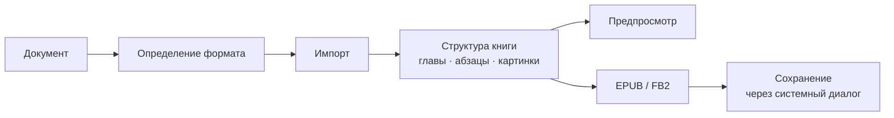

# EbookConverter

**Нативное приложение для macOS, которое превращает документы в электронные книги для PocketBook и других читалок.**

Перетащите файл в окно, посмотрите, как будет выглядеть книга, поправьте название, автора и обложку и сохраните в EPUB или FB2. Без облаков, регистрации и сторонних сервисов: всё происходит на вашем Mac.


---

## Возможности

- **Девять входных форматов**: TXT, Markdown, RTF, DOC, DOCX, HTML, PDF, EPUB и FB2. Формат определяется по содержимому файла, а не по расширению, поэтому RTF, сохранённый как `.doc`, тоже откроется.
- **Два формата на выходе**:
  - **EPUB 3** с запасными элементами EPUB 2: оглавление `toc.ncx` и ссылки на обложку для старых прошивок PocketBook.
  - **FB2 2.0**, родной формат для многих читалок.
- **Конвертация книг между собой**: EPUB → FB2 и FB2 → EPUB без потери глав, оглавления и картинок.
- **Предпросмотр книги**: слева оглавление, по центру текст главы с картинками, ровно таким, каким он попадёт в файл.
- **Точный размер книги до сохранения**: книга собирается в памяти, и показанный размер совпадает с размером сохранённого файла байт в байт.
- **Обложка в три клика**:
  - находится автоматически, если в начале документа есть подходящая картинка;
  - генерируется из названия и автора, если картинки нет;
  - заменяется своей: перетащите JPEG, PNG или HEIC на обложку или нажмите «Выбрать…».
- **Редактирование метаданных**: название, автор, язык книги (список всех языков мира, язык определяется автоматически).

## Умное распознавание структуры

Приложение само собирает оглавление, даже если в исходнике его нет:

- главы находятся по крупному шрифту, жирному начертанию и типичным заголовкам на многих языках: «Глава 1», «Часть II», *Chapter*, *Kapitel*, *Chapitre*, *Capítulo*, 第一章, 제1장 и другие;
- поддерживается двухуровневая структура «Часть → Глава»;
- в TXT учитываются строки капсом, отступы и жёсткие переносы;
- из PDF собираются нормальные абзацы:
  - строки склеиваются, переносы слов убираются;
  - колонтитулы и номера страниц вырезаются;
  - вёрстка в две колонки читается в правильном порядке;
  - картинки извлекаются и ставятся на свои места.

## Любой язык

- Интерфейс на русском и английском. Новый язык добавляется переводом строк, без изменения кода.
- Кодировка и язык определяются автоматически: Windows-1251, KOI8-R, Shift-JIS, GB18030, UTF-16 и другие.
- Книги справа налево (арабский, иврит, персидский) помечаются в EPUB правильно и так же показываются в предпросмотре.
- Китайский и японский текст склеивается без лишних пробелов.

## Как это работает



Предпросмотр и итоговый файл строятся из одной и той же модели книги, поэтому на экране вы видите ровно то, что окажется в файле.

## Приватность и безопасность

- Приложение работает в песочнице macOS (App Sandbox) и видит только файлы, которые вы сами открыли или перетащили.
- Ничего не загружается из интернета: картинки по ссылкам из HTML и Markdown пропускаются, и программа об этом предупреждает.
- Файлы записываются только через системный диалог сохранения, рядом с исходником ничего не создаётся.
- Для картинок, которые лежат рядом с Markdown- или HTML-файлом, приложение один раз попросит доступ к папке.

## Требования

- macOS 26 или новее.
- Для сборки: Xcode 27 и Swift 6.

## Сборка

```bash
git clone <repo-url> EbookConverter
cd EbookConverter
open EbookConverter.xcodeproj        # затем ⌘R
```

Или из терминала:

```bash
xcodebuild -project EbookConverter.xcodeproj -scheme EbookConverter -destination 'platform=macOS' build
```

### Тесты

Вся логика (импорт, распознавание структуры, запись EPUB/FB2, модель окна) вынесена в Swift-пакет `Packages/EbookCore` и покрыта тестами на Swift Testing, больше 300 тестов:

```bash
swift test --package-path Packages/EbookCore --scratch-path ~/Library/Caches/EbookConverter/swiftpm
```

Каждая собранная EPUB проверяется официальным [EPUBCheck](https://github.com/w3c/epubcheck). Нужна Java, например `brew install openjdk`:

```bash
tools/epubcheck.sh book.epub
```

## Технологии

| Задача | Что используется |
|---|---|
| Интерфейс | SwiftUI, `@Observable`, Liquid Glass |
| Документы Word / RTF / HTML | `NSAttributedString` |
| PDF | PDFKit, Core Graphics (`CGPDFScanner`) |
| ZIP для EPUB | собственная реализация на фреймворке Compression |
| Язык текста | NaturalLanguage |
| Картинки | ImageIO |
| Тесты | Swift Testing, EPUBCheck |

Сторонних зависимостей нет.

## Структура проекта

```
EbookConverter/            приложение: окно, предпросмотр, инспектор, обложка
Packages/EbookCore/        вся логика конвертации и модель окна (Swift-пакет)
tools/epubcheck.sh         проверка EPUB официальным валидатором
docs/acceptance.md         результаты приёмки и ручной чек-лист
```

Результаты приёмочной проверки и ручной чек-лист — в [docs/acceptance.md](docs/acceptance.md).

## Статус

MVP готов: конвертация всех девяти форматов в EPUB и FB2, предпросмотр, обложки и метаданные работают; каждая EPUB проходит EPUBCheck без ошибок.

## Планы

- [ ] Исправить: при конвертации из PDF не учитываются отступы новых абзацев от левого края страницы
- [ ] Исправить склейку стихов и китайского текста с отступами в TXT
- [ ] Окно сравнения: оригинальный документ рядом с получившейся книгой и возможность поправить книгу перед сохранением
- [ ] Распознавание жирных заголовков в PDF
- [ ] Пакетная конвертация нескольких файлов
- [ ] Распознавание сканов (OCR)
- [ ] Публикация в Mac App Store

## Лицензия

Пока не выбрана.
